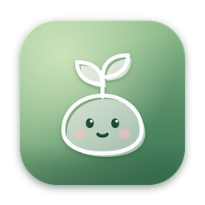

<p align="center">
  
</p>

<h1 align="center">Pausa</h1>

<p align="center">
  A small desktop companion for mindful pauses at work.<br>
  <a href="https://marcosesalves.github.io/pausa-landing-page/">Website</a> ·
  <a href="https://www.instagram.com/pausa.companion/">Instagram</a>
</p>

Pausa nudges you, gently and on your own schedule, to step away from the screen for a minute. Each nudge is a
short tip: a breath, a stretch, a glance out of the window, a kind thought. Pip, a little sprout, keeps you
company and grows with every pause you take.

> **Beta.** Pausa is at version 0.2.0-beta.1. It works, but expect rough edges, and please tell us about them.

## What it does

- **Tips for short pauses.** Pick the categories you like (breathing, body scan, gratitude, nature, movement,
  focus and more) and how often you want a nudge. Each tip opens as a calm card over your work. Take the moment, or skip it.
- **Breathing exercises.** Six techniques (box, 4-7-8, long exhale, triangle, coherent and sigh) with a guided orb and Pip
  breathing along. You can add a breath before or after any pause.
- **Water and posture reminders.** Two small reminders of their own, with their own timing.
- **Pip and the garden.** Every pause counts. Pip grows through stages and your garden fills as you go.
- **Your rhythm.** Quiet hours, a pause button, and light, dark or system theme.
- **Private by default.** Everything stays on your computer. The only network use is the optional feedback
  form, and it sends only what you tick.

## Install the beta

### Windows 11 (64-bit)

With winget:

```powershell
winget install MarcosAlves.Pausa
```

Or download `Pausa_<version>_x64-setup.exe` from the [releases page](../../releases) and run it. It
installs for your user only, with no administrator rights.

The installer is not code signed yet, so Windows SmartScreen may show "Windows protected your PC". Choose
**More info**, then **Run anyway**. To check the file first, compare the SHA-256 in the release notes with
`Get-FileHash <file>`.

### macOS

**Apple silicon (M1 or later):** download `Pausa_<version>_aarch64.dmg` from the
[releases page](../../releases), open it and drag **Pausa** into **Applications**.

Pausa is not signed with an Apple Developer certificate yet, so macOS blocks it the first time. Open Pausa and
click **Done** on the warning, then open **System Settings, Privacy & Security**, scroll to **Security**, click
**Open Anyway** and confirm. If macOS says the app "is damaged and can't be opened", that is the same block for
unsigned downloads; run this once in Terminal and open Pausa again:

```bash
xattr -dr com.apple.quarantine /Applications/Pausa.app
```

**Intel Macs, or if you prefer to build it yourself:** you need [Node.js](https://nodejs.org) 20 or newer, a
stable [Rust](https://rustup.rs) toolchain and the Xcode command line tools (`xcode-select --install`).

```bash
git clone https://github.com/marcosesalves/pausa.git
cd pausa
npm install
npm run tauri build -- --bundles app
```

The app is created at `src-tauri/target/release/bundle/macos/Pausa.app`. Drag it into **Applications** and open
it. Pausa lives in your menu bar (the sprout icon) and the Dock. Left-click the icon to open it, and use the
right-click menu to quit.

## Run it from source

```bash
npm install
npm run tauri dev
```

Checks that CI runs: `npm run validate:tips` and `npx tsc --noEmit`. Rust tests: `cargo test` in `src-tauri`.

## Feedback and bugs

Use **Settings, Help us improve Pausa** in the app, or the menu bar icon's menu on macOS. Reports go to a small
Supabase function (`supabase/functions/submit-feedback`) that holds no personal data beyond what you choose to
include. In your own build, set `PAUSA_FEEDBACK_URL` to your project URL; without it the form says feedback is
off. You can also [open an issue](../../issues). Updates and news are on
[Instagram](https://www.instagram.com/pausa.companion/).

## Releases

Pushing a tag such as `v0.2.0-beta.2` builds the Windows installer in GitHub Actions and attaches it, with its
SHA-256, to a GitHub release. The winget manifests are in `packaging/winget`.

## License

[MIT](LICENSE)
